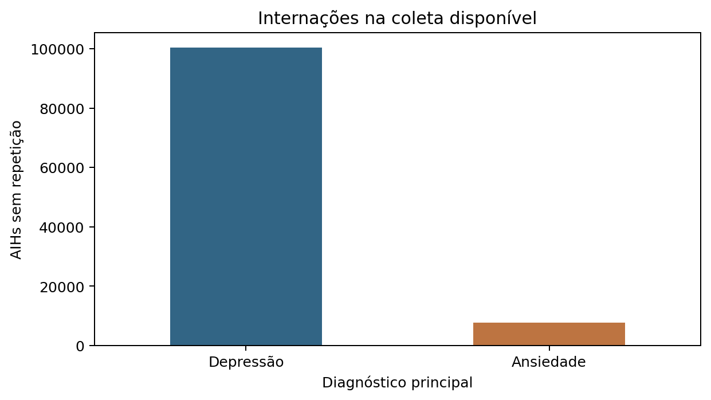
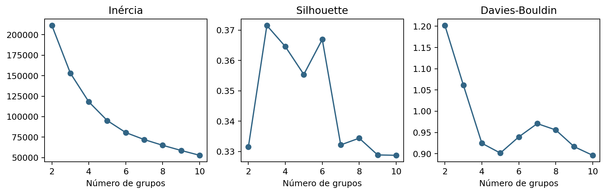
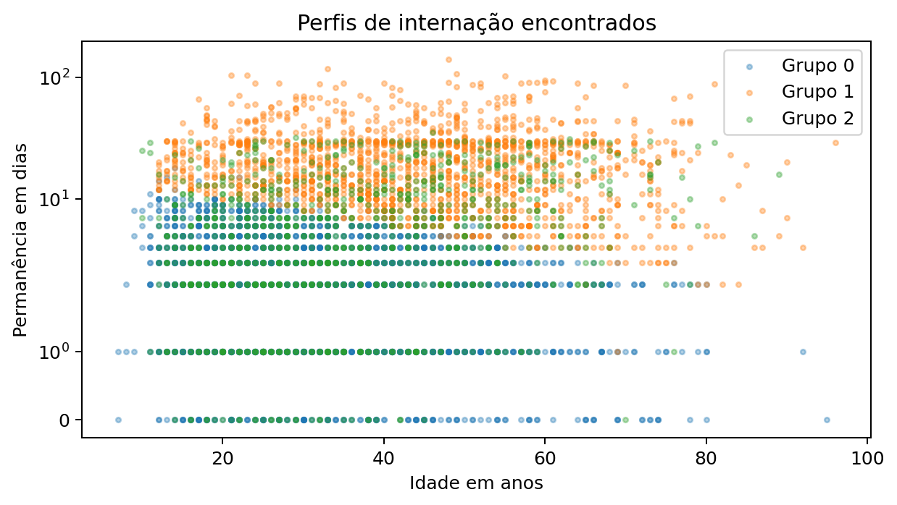

# Perfis de internação por depressão e ansiedade no SUS

Matheus Alves dos Santos  
Thamires Sant'Ana  
Vinicius Riani

Análise de uma coleta parcial das competências de processamento de 2023 a 2025

## Resumo

Neste projeto, nós analisamos registros de internação do SUS para entender quais perfis aparecem nos diagnósticos principais de depressão e ansiedade e quais características costumam ocorrer juntas. Usamos arquivos reduzidos do Sistema de Informações Hospitalares do SUS, selecionando os códigos F32, F33, F40 e F41. A consulta retornou 764 dos 972 arquivos esperados para os 26 estados e o Distrito Federal, entre 2023 e 2025. A coleta é parcial e seus totais não representam todas as internações do Brasil no período. Antes da limpeza, obtivemos 118.173 registros dos diagnósticos selecionados. A base analisada ficou com 108.151 AIHs normais válidas, sem repetição de identificador no recorte, com 8.376 AIHs de continuação consolidadas nas 5.821 AIHs iniciais correspondentes. Aplicamos K-Means a idade, permanência e pagamento registrado, com transformação logarítmica e padronização, e selecionamos 3 grupos. A silhouette amostral foi 0,372. Também usamos Apriori para encontrar associações com suporte de pelo menos 5%, confiança de 60% e lift de 1,10. Os resultados descrevem o conjunto coletado e não permitem estimar prevalência, estabelecer causa e efeito ou comparar totais anuais como tendência nacional.

Palavras-chave: SIH/SUS; depressão; ansiedade; K-Means; regras de associação.

## 1 Introdução

Depressão e ansiedade podem aparecer em diferentes situações de atendimento. Neste trabalho, nós escolhemos olhar para as internações financiadas pelo SUS. O objetivo foi entender como esses registros se distribuem e verificar se idade, tempo de permanência e pagamento registrado formam perfis diferentes dentro da base disponível.

Para isso, usamos os arquivos SIH-RD do DATASUS e selecionamos somente o diagnóstico principal. F32 e F33 foram reunidos como depressão; F40 e F41, como ansiedade. Esse recorte permite uma análise delimitada, mas não inclui todos os transtornos de humor ou de ansiedade. Também não inclui casos em que esses códigos aparecem apenas como diagnóstico secundário.

A proposta foi combinar duas formas de análise. Com o agrupamento, buscamos internações parecidas nos atributos numéricos. Com as regras de associação, buscamos características que aparecem juntas com frequência. Essas etapas ajudam a descrever os dados, sem transformar o resultado de um algoritmo em classificação clínica.

## 2 Justificativa

Escolhemos o SIH/SUS porque ele oferece registros públicos com diagnóstico principal, idade, sexo, permanência e pagamento. Esses campos permitem estudar o atendimento hospitalar com mais detalhe do que uma tabela que contém apenas o total de internações. A origem e o significado de cada campo precisam acompanhar a análise, porque um registro administrativo não explica, sozinho, toda a situação de saúde de uma pessoa.

O planejamento considerou 2023 a 2025 para trabalhar com anos de calendário encerrados e evitar misturar diretamente o início da pandemia com o período seguinte. Isso não significa que os efeitos da pandemia tenham terminado. Também não garante que todo arquivo esteja publicado ou não seja revisado. Durante a coleta, encontramos faltas no espelho consultado, e mantivemos esse limite explícito no estudo.

A escolha de reunir as unidades federativas aumentou a diversidade de registros disponíveis. Mesmo assim, a cobertura obtida não é uma amostra probabilística do país. Nossa justificativa para analisar o conjunto é explorar seus perfis, sem calcular estimativas nacionais a partir dos meses ausentes.

## 3 Revisão da literatura

Carvalho et al. (2023) analisaram internações por transtornos mentais e comportamentais de janeiro de 2008 a julho de 2021. No estudo de série temporal interrompida, os autores encontraram redução de 8% nas taxas após o início da pandemia. Esse resultado ajuda a entender por que menos internações registradas não devem ser interpretadas automaticamente como melhora da saúde mental: o acesso e a organização do cuidado também precisam ser considerados.

Papini et al. (2025) examinaram internações por transtornos mentais e comportamentais entre 2018 e 2024. Os autores relataram uma queda de 17,2% em 2020 e posterior aumento. Os dois estudos usam um conjunto de diagnósticos mais amplo que o nosso. Por isso, suas contagens e percentuais não servem como valores esperados para F32, F33, F40 e F41. Eles ajudam a contextualizar a escolha do período, sem substituir a análise dos nossos registros.

No agrupamento, o K-Means separa observações em grupos a partir da distância entre os atributos e seus centros. Utilizamos a implementação do scikit-learn, biblioteca descrita por Pedregosa et al. (2011). A padronização e a transformação dos atributos foram feitas antes do ajuste para que idade e valores monetários não fossem comparados diretamente em escalas incompatíveis.

Para as associações, usamos Apriori, apresentado por Agrawal e Srikant (1994), por meio da biblioteca mlxtend, descrita por Raschka (2018). O método procura conjuntos frequentes de itens e permite formar regras do tipo antecedente para consequente. A confiança depende dessa direção: ela representa a proporção do consequente entre os registros que possuem o antecedente, e não o contrário.

## 4 Metodologia e resultados

### 4 1 Base de dados e coleta

A base de origem é o Sistema de Informações Hospitalares do SUS, no grupo RD, com arquivos reduzidos de AIH. A consulta foi feita pelo PySUS 2.11.7. Nessa versão, o acesso padrão utiliza um espelho público de arquivos Parquet. Usamos a API para identificar os arquivos e seus metadados, e conferimos o SHA-256 na transferência. O catálogo salvo informa endereço, unidade federativa, competência, tamanho e versão de cada arquivo (BRASIL, 2015; PYSUS, s.d.).

O recorte solicitado corresponde a 27 unidades federativas, 36 competências de processamento e 972 arquivos. A fonte consultada disponibilizou 764 arquivos, equivalentes a 78,60% das combinações esperadas. Todos os arquivos disponibilizados para esse recorte foram baixados. Os 208 ausentes no catálogo foram registrados separadamente e não receberam contagem zero. Isso é uma limitação do conjunto obtido por essa rota, não uma afirmação de que os arquivos estejam ausentes de todos os servidores do DATASUS.

Tabela 1 Cobertura por ano de processamento
Ano | Esperados | Obtidos | Ausentes
2023 | 324 | 250 | 74
2024 | 324 | 252 | 72
2025 | 324 | 262 | 62

Fonte: elaboração própria, a partir dos arquivos SIH-RD efetivamente coletados.

Ano e mês referem-se ao processamento do arquivo. Uma internação pode começar ou terminar em outro período. A UF extraída do arquivo indica o atendimento, e não necessariamente a residência. Como faltam competências em vários estados, não usamos os totais anuais para afirmar crescimento ou queda nacional.

Tabela 2 Campos utilizados na análise
Campo | Informação e uso
N_AIH e IDENT | Identificação da AIH, seleção das normais e consolidação das continuações
DIAG_PRINC | Diagnóstico principal e seleção dos quatro prefixos CID-10
IDADE e COD_IDADE | Idade e unidade usada para convertê-la em anos
SEXO | Sexo registrado no SIH
DT_INTER e DT_SAIDA | Validação das datas de entrada e saída
DIAS_PERM | Permanência registrada, em dias
VAL_TOT | Pagamento total registrado na AIH, em reais nominais
MORTE | Óbito informado, preservando valores desconhecidos
CAR_INT | Caráter eletivo, urgência ou outros códigos previstos
UF e competência | Procedência do arquivo e análise de cobertura

Fonte: elaboração própria, a partir dos arquivos SIH-RD efetivamente coletados.

### 4 2 Preparação dos registros

A seleção dos quatro prefixos como diagnóstico principal produziu 118.173 registros antes da limpeza. Trabalhamos com AIH normal, IDENT igual a 1, como unidade de internação. As 10.006 AIHs de continuação, IDENT igual a 5, não foram contadas como novas internações. Em vez de descartá-las sem aproveitamento, o que truncaria a permanência e o pagamento das internações de longa duração, consolidamos as 8.376 continuações pertencentes a um mesmo identificador de AIH normal válida, somando seus dias de permanência e pagamentos e atualizando a data de saída e o registro de óbito. Essa consolidação abrangeu 5.821 internações da base final. As 1.630 continuações cuja AIH inicial válida não estava presente no recorte coletado foram excluídas. Como a coleta é parcial, continuações faturadas em meses ausentes do catálogo ou após o período selecionado podem não constar nos arquivos coletados.

Depois das exclusões, da retirada de identificadores repetidos entre AIHs normais e da consolidação das continuações, restaram 108.151 registros. Cada exclusão foi contada somente entre os registros que ainda estavam na base, evitando somar o mesmo registro em dois motivos.

Tabela 3 Exclusões e consolidações aplicadas em sequência
Motivo | Registros
AIH diferente de normal ou continuação | 0
Identificador ausente ou inválido | 0
Sexo ausente ou inválido | 0
Idade ausente ou inválida | 16
Datas ausentes ou invertidas | 0
Permanência ausente ou negativa | 0
Valor ausente ou negativo | 0
AIH repetida no recorte | 0
AIH de continuação consolidada na AIH inicial | 8.376
AIH de continuação sem AIH inicial válida no recorte | 1.630

Fonte: elaboração própria, a partir dos arquivos SIH-RD efetivamente coletados.

Convertemos idade conforme a unidade registrada. Dias foram divididos por 365,25 e meses por 12; idades registradas em anos foram mantidas. No código de cem anos ou mais, somamos 100 ao valor informado. Unidades ausentes ou desconhecidas ficaram ausentes (CERQUEIRA et al., 2019). Datas foram lidas no formato AAAAMMDD, sem tentar interpretar números inválidos como outro formato de data. Esse cuidado evita alterar o perfil dos grupos por erro de conversão.

Para AIHs normais repetidas dentro do conjunto obtido, mantivemos a competência de processamento mais recente disponível. Isso reduz repetições do mesmo identificador, mas não identifica pessoas únicas: uma pessoa pode ter mais de uma AIH. Exigimos identificador numérico de 13 dígitos, sexo válido, idade entre 1 e 120 anos, datas coerentes, permanência não negativa e pagamento não negativo. O limite etário de 1 a 120 anos excluiu 16 registros implausíveis ou errôneos no recorte: 12 referentes a menores de 1 ano, incluindo recém-nascidos com diagnóstico principal de depressão, e 4 registros acima de 120 anos atribuídos a provável erro de preenchimento da unidade de idade. Pagamentos iguais a zero foram mantidos: eles não foram classificados automaticamente como erro, e logaritmo de 1 mais o valor permite tratá-los sem descartar a internação. Esses critérios definem a base estudada e podem deixar de fora registros que seriam relevantes sob outro objetivo.

O campo de óbito ficou ausente em 0 registros da base final, com 246 óbitos informados, incluindo 4 ocorridos durante AIHs de continuação e preservados pela consolidação. Não preenchemos esse campo com zero. Quando calculada uma proporção de óbitos, o denominador considera apenas os registros com informação válida. Também mantivemos o pagamento nominal, sem ajuste pela inflação, e usamos VAL_TOT como pagamento registrado na AIH, não como medida do custo integral do tratamento.

### 4 3 Características da base obtida

Na base analisada, 100.452 registros foram classificados no grupo de depressão e 7.699 no de ansiedade. Isso corresponde a 92,88% e 7,12%, respectivamente. A diferença descreve os diagnósticos principais hospitalares selecionados. Ela não indica que a depressão seja essa quantidade de vezes mais frequente que a ansiedade na população.

Tabela 4 Resumo dos diagnósticos na coleta parcial
Diagnóstico | AIHs | Idade mediana | Dias medianos | Pagamento mediano
Ansiedade | 7.699 | 33,0 | 2,0 | R$ 57,00
Depressão | 100.452 | 35,0 | 5,0 | R$ 165,66

Fonte: elaboração própria, a partir dos arquivos SIH-RD efetivamente coletados.

O sexo feminino apareceu em 70.378 registros, ou 65,07% da base. A região com mais registros disponíveis foi Sul, com 45.922, o equivalente a 42,46% do total coletado. Essa distribuição depende tanto dos atendimentos quanto da cobertura obtida em cada local: a região Sul apresentou cobertura de 87,04% dos arquivos esperados, enquanto Sudeste teve 77,78% e Norte, 72,22%. Não usamos esses totais para comparar risco entre regiões, porque não há denominadores populacionais nem cobertura uniforme.

Figura 1 Distribuição dos diagnósticos principais selecionados

Fonte: elaboração própria, com os dados desta coleta parcial.

### 4 4 Agrupamento dos perfis

O objetivo do agrupamento foi encontrar perfis numéricos de internação, usando idade em anos, dias de permanência e pagamento registrado. Sexo, diagnóstico e região ficaram fora da distância do K-Means e foram usados para interpretar os grupos. Codificar essas categorias com números arbitrários criaria uma distância sem significado entre elas.

Aplicamos logaritmo de 1 mais o valor à permanência e ao pagamento para reduzir a influência dos extremos sem removê-los automaticamente. Depois, usamos padronização para média zero e desvio padrão unitário. Assim, o tamanho de uma unidade em reais não domina a comparação com uma unidade de idade. Não transformamos idade em logaritmo, porque sua interpretação em anos foi preservada.

Testamos k de 2 a 10, com dez inicializações por ajuste e semente 42. A silhouette foi calculada sobre a mesma amostra fixa de 10.000 observações em todos os valores de k. Isso reduz o custo computacional e diminui o ruído amostral na comparação entre números de grupos. A inércia e o índice Davies-Bouldin foram calculados na base completa. Escolhemos a maior silhouette, com Davies-Bouldin como desempate. O valor selecionado foi k igual a 3, com silhouette 0,372 e Davies-Bouldin 1,061. A inércia também foi apresentada para permitir a leitura do cotovelo, sem tratá-la como uma escolha automática independente. A silhouette encontrada indica separação limitada, com sobreposição entre os perfis, e não comprova grupos clínicos naturais.

Tabela 5 Comparação dos números de grupos
k | Silhouette amostral | Davies Bouldin | Inércia
2 | 0,3316 | 1,202 | 211.250,1
3 | 0,3715 | 1,061 | 153.133,1
4 | 0,3646 | 0,925 | 118.060,9
5 | 0,3554 | 0,902 | 95.207,7
6 | 0,3669 | 0,940 | 80.600,7
7 | 0,3322 | 0,971 | 72.049,8
8 | 0,3344 | 0,956 | 65.052,3
9 | 0,3289 | 0,916 | 58.759,3
10 | 0,3288 | 0,896 | 52.865,2

Fonte: elaboração própria, a partir dos arquivos SIH-RD efetivamente coletados.

Figura 2 Métricas usadas na escolha do número de grupos

Fonte: elaboração própria, com os dados desta coleta parcial.

Tabela 6 Perfis dos grupos encontrados
Grupo | AIHs | Idade mediana | Dias medianos | Pagamento mediano
0 | 50.379 | 30,0 | 2,0 | R$ 114,00
1 | 36.828 | 44,0 | 18,0 | R$ 951,60
2 | 20.944 | 35,0 | 5,0 | R$ 0,00

Fonte: elaboração própria, a partir dos arquivos SIH-RD efetivamente coletados.

Figura 3 Distribuição dos grupos encontrados em idade e permanência

Fonte: elaboração própria, com os dados desta coleta parcial.

O grupo 0 reuniu 50.379 AIHs, com idade mediana de 30,0 anos, permanência mediana de 2,0 dias e pagamento mediano de R$ 114,00. Nesse grupo, 66,28% dos registros foram do sexo feminino, 89,62% tiveram depressão como grupo de diagnóstico principal e nenhum registro teve pagamento igual a zero. Esses valores ajudam a descrever o perfil encontrado, sem dar ao rótulo do algoritmo um significado clínico.

O grupo 1 reuniu 36.828 AIHs, com idade mediana de 44,0 anos, permanência mediana de 18,0 dias e pagamento mediano de R$ 951,60. Nesse grupo, 62,94% dos registros foram do sexo feminino, 96,23% tiveram depressão como grupo de diagnóstico principal e nenhum registro teve pagamento igual a zero. A consolidação das AIHs de continuação elevou a permanência e o pagamento medianos desse perfil em relação à análise sem continuações, refletindo melhor as internações de longa duração.

O grupo 2 reuniu 20.944 AIHs, com idade mediana de 35,0 anos, permanência mediana de 5,0 dias e pagamento mediano de R$ 0,00. Nesse grupo, 65,93% dos registros foram do sexo feminino e 94,84% tiveram depressão como grupo de diagnóstico principal. Todos os 20.944 registros do grupo 2 tiveram pagamento registrado igual a zero.

Para verificar se o ajuste mudava muito com a inicialização, repetimos o K-Means com cinco sementes e comparamos todos os dez pares por ARI. A média foi 0,997 e o menor valor foi 0,996. Esses números avaliam repetibilidade no mesmo conjunto de atributos. Não representam precisão diagnóstica ou validação em outra população.

A correlação de Spearman entre permanência e pagamento foi 0,592. Mantivemos os dois atributos porque representam dimensões diferentes do registro, mas essa relação precisa ser considerada na leitura dos grupos. Os perfis podem refletir formas de remuneração e organização dos atendimentos, além das diferenças na permanência. Não afirmamos que pagamento maior signifique doença mais grave.

O pagamento igual a zero apareceu em 20.944 registros, ou 19,37% da base, e o grupo 2 correspondeu exatamente a esse subconjunto, sem nenhum registro com valor positivo. Como o menor pagamento positivo na base foi R$ 21,98, a transformação logarítmica criou um salto de 1,25 desvio padrão entre zero e os valores positivos no eixo padronizado, levando o algoritmo a isolar esses registros em um grupo próprio. Como se vê na Figura 3, o grupo 2 se sobrepõe aos grupos 0 e 1 em idade e permanência. Além disso, a proporção de pagamentos iguais a zero varia de forma acentuada entre estados, passando de 0% na Bahia e no Espírito Santo a 48,82% em Minas Gerais e 63,02% no Tocantins, o que indica diferenças administrativas de faturamento e orçamentação, e não um perfil assistencial homogêneo. Não interpretamos zero como ausência de custo do atendimento nem como menor gravidade. Para verificar a dependência desse atributo, ajustamos outro K-Means com o mesmo k, usando apenas idade padronizada e logaritmo da permanência padronizado. O ARI entre os dois ajustes foi 0,309. Esse ARI, muito abaixo da estabilidade entre sementes, mostra que os grupos mudam de forma relevante quando retiramos pagamento. Portanto, a repetibilidade do ajuste não elimina sua dependência da escolha dos atributos. A comparação não escolhe um segundo modelo final.

### 4 5 Regras de associação

Na etapa de associação, cada internação foi tratada como uma transação. Usamos diagnóstico, sexo, faixa etária, região de atendimento, caráter da internação, permanência e pagamento em faixas. O óbito informado como positivo também foi incluído como item, sem criar um item de sobrevivência para valores ausentes. Os rótulos do K-Means não entraram nessa etapa, evitando que as regras apenas repetissem a definição dos grupos.

Idade foi dividida nas faixas de 1 a 11, 12 a 17, 18 a 29, 30 a 44, 45 a 59 e 60 anos ou mais. Para permanência e pagamento, usamos cortes nos quantis de um terço e dois terços. As faixas foram numeradas em ordem crescente e os limites exatos ficaram salvos no arquivo limites_faixas.csv. Os empates nos valores podem deixar as faixas com tamanhos diferentes.

Tabela 7 Limites das faixas numéricas
Categoria | Limite inferior aberto | Limite superior fechado
permanencia_faixa_1 | sem limite inferior | 3,0000
permanencia_faixa_2 | 3,0000 | 10,0000
permanencia_faixa_3 | 10,0000 | sem limite superior
valor_faixa_1 | sem limite inferior | 57,0000
valor_faixa_2 | 57,0000 | 390,0000
valor_faixa_3 | 390,0000 | sem limite superior

Fonte: elaboração própria, a partir dos arquivos SIH-RD efetivamente coletados.

O Apriori considerou suporte mínimo de 5%, conjuntos com até três itens, confiança mínima de 60% e lift de pelo menos 1,10. O suporte de 5% corresponde a pelo menos 5.408 registros com o conjunto de itens. Com esses parâmetros, obtivemos 45 regras. Após retirar da seleção interpretada as regras que combinavam pagamento e permanência, restaram 9, apresentadas na íntegra nas Tabelas 8 a 16. O arquivo completo continua disponível, porque esse filtro é uma escolha de interpretação e não invalida as regras calculadas.

O suporte informa a fração da base com antecedente e consequente ao mesmo tempo. A confiança informa a fração que tem o consequente entre os registros que têm o antecedente. O lift compara essa confiança com a frequência geral do consequente: acima de 1 indica que a combinação é mais frequente do que seria sob independência. Esses números não demonstram que o antecedente cause o consequente.

Tabela 8 Regra de associação 1
Antecedente | Consequente | Suporte | Confiança | Lift
Caráter: Eletivo e Diagnóstico: Depressão | Permanência acima de 10 dias | 6,91% | 64,53% | 2,040

Fonte: elaboração própria, a partir dos arquivos SIH-RD efetivamente coletados.

Tabela 9 Regra de associação 2
Antecedente | Consequente | Suporte | Confiança | Lift
Caráter: Eletivo | Permanência acima de 10 dias | 7,23% | 63,84% | 2,018

Fonte: elaboração própria, a partir dos arquivos SIH-RD efetivamente coletados.

Tabela 10 Regra de associação 3
Antecedente | Consequente | Suporte | Confiança | Lift
Caráter: Eletivo | Diagnóstico: Depressão e Permanência acima de 10 dias | 6,91% | 60,98% | 1,997

Fonte: elaboração própria, a partir dos arquivos SIH-RD efetivamente coletados.

Tabela 11 Regra de associação 4
Antecedente | Consequente | Suporte | Confiança | Lift
Idade de 12 a 17 anos | Caráter: Urgência e Sexo feminino | 7,04% | 74,21% | 1,282

Fonte: elaboração própria, a partir dos arquivos SIH-RD efetivamente coletados.

Tabela 12 Regra de associação 5
Antecedente | Consequente | Suporte | Confiança | Lift
Caráter: Urgência e Idade de 12 a 17 anos | Sexo feminino | 7,04% | 78,34% | 1,204

Fonte: elaboração própria, a partir dos arquivos SIH-RD efetivamente coletados.

Tabela 13 Regra de associação 6
Antecedente | Consequente | Suporte | Confiança | Lift
Idade de 12 a 17 anos e Diagnóstico: Depressão | Sexo feminino | 6,83% | 78,20% | 1,202

Fonte: elaboração própria, a partir dos arquivos SIH-RD efetivamente coletados.

Tabela 14 Regra de associação 7
Antecedente | Consequente | Suporte | Confiança | Lift
Idade de 12 a 17 anos | Sexo feminino | 7,40% | 77,97% | 1,198

Fonte: elaboração própria, a partir dos arquivos SIH-RD efetivamente coletados.

Tabela 15 Regra de associação 8
Antecedente | Consequente | Suporte | Confiança | Lift
Idade de 12 a 17 anos | Diagnóstico: Depressão e Sexo feminino | 6,83% | 71,97% | 1,194

Fonte: elaboração própria, a partir dos arquivos SIH-RD efetivamente coletados.

Tabela 16 Regra de associação 9
Antecedente | Consequente | Suporte | Confiança | Lift
Atendimento na região Centro-Oeste | Caráter: Urgência e Sexo feminino | 5,74% | 67,83% | 1,172

Fonte: elaboração própria, a partir dos arquivos SIH-RD efetivamente coletados.

Na primeira regra apresentada, o antecedente reúne caráter eletivo e depressão como grupo do diagnóstico principal, e o consequente é permanência acima de 10 dias. O suporte de 6,91% significa que os dois lados ocorreram juntos nessa proporção da base. A confiança de 64,53% se refere aos registros que já tinham o antecedente. O lift de 2,040 compara essa confiança à frequência geral do consequente. A contagem conjunta foi de 7.470 AIHs. A regra descreve uma associação no conjunto obtido, sem permitir identificar o motivo clínico ou administrativo dessa relação.

As nove regras se organizam em três padrões principais no conjunto analisado: a associação entre internações eletivas e permanência acima de 10 dias (Tabelas 8 a 10), a concentração de registros do sexo feminino e de caráter de urgência na faixa de 12 a 17 anos (Tabelas 11 a 15) e a associação entre atendimento na região Centro-Oeste e caráter de urgência com sexo feminino (Tabela 16). Na regra regional, convém considerar que a cobertura de arquivos não foi uniforme entre regiões, com 86,81% no Centro-Oeste, o que influencia o peso dessa região na base coletada.

A seleção foi ordenada por lift, confiança e suporte. Regras diferentes podem compartilhar itens e não devem ser contadas como descobertas independentes. O suporte mínimo também impede que combinações raras apareçam, mesmo quando merecem atenção em outro tipo de estudo. Não reduzimos o limiar depois de olhar os resultados apenas para obter mais regras sobre ansiedade ou óbito.

## 5 Conclusão

Neste projeto, conseguimos preparar e analisar 108.151 registros de AIH normal com diagnóstico principal nos quatro prefixos escolhidos, consolidando 8.376 AIHs de continuação nas 5.821 AIHs iniciais correspondentes. A depressão correspondeu a 92,88% da base obtida, e a ansiedade a 7,12%. O K-Means separou 3 perfis de internação, descritos por idade, permanência e pagamento. Um dos grupos correspondeu exatamente aos registros com pagamento igual a zero, mostrando que parte da separação reflete o registro administrativo e o salto produzido pela transformação logarítmica. O Apriori mostrou combinações frequentes de características e permitiu comparar sua força por suporte, confiança e lift.

A principal limitação foi a cobertura: obtivemos 764 dos 972 arquivos esperados no espelho consultado. A ausência de meses não pode ser tratada como ausência de casos e também pode deixar de fora continuações faturadas em competências ausentes. Por isso, os achados valem para o conjunto efetivamente analisado, e não para o total nacional. Também precisamos considerar que AIHs não são pessoas únicas, que diagnósticos secundários ficaram de fora e que os valores de pagamento não foram corrigidos pela inflação.

Os trabalhos de Carvalho et al. (2023) e Papini et al. (2025) mostram que as internações por transtornos mentais variaram em períodos que incluem a pandemia. O nosso recorte, os diagnósticos e a cobertura são diferentes. Portanto, não usamos esses estudos para afirmar que os nossos grupos sejam efeitos da pandemia nem para validar os totais encontrados. A relação com a literatura está no cuidado necessário para interpretar o registro hospitalar junto ao acesso e à organização dos serviços.

Para continuar o estudo, o primeiro passo é completar as competências ausentes e repetir a análise. Depois, é possível testar agrupamentos separados para registros com e sem pagamento registrado, bem como aplicar correção monetária aos pagamentos. O código e as tabelas entregues permitem refazer essas etapas sem ocultar mudanças de cobertura ou de critérios.

## 6 Referências

AGRAWAL, Rakesh; SRIKANT, Ramakrishnan. Fast algorithms for mining association rules in large databases. In: INTERNATIONAL CONFERENCE ON VERY LARGE DATA BASES, 20., 1994, Santiago. Proceedings [...]. 1994. p. 487–499. Disponível em: https://www.vldb.org/conf/1994/P487.PDF. Acesso em: 12 nov. 2026.

BRASIL. Ministério da Saúde. DATASUS. Dicionário de dados do SIH/SUS. Versão de agosto de 2015. Disponível em: https://ccvisat.ufba.br/wp-content/uploads/2019/10/Dicion%C3%A1rio_-SIH_SUS.pdf. Acesso em: 12 nov. 2026.

BRASIL. Ministério da Saúde. DATASUS. Morbidade hospitalar do SUS — SIH/SUS. Disponível em: https://datasus.saude.gov.br/acesso-a-informacao/morbidade-hospitalar-do-sus-sih-sus/. Acesso em: 12 nov. 2026.

CARVALHO, Carolina Novaes; FORTES, Sandra; CASTRO, André Peres Barbosa de; CORTEZ-ESCALANTE, Juan; ROCHA, Thiago Augusto Hernandes. A pandemia de covid-19 e a morbidade hospitalar por transtorno mental e comportamental no Brasil: uma análise de série temporal interrompida, janeiro de 2008 a julho de 2021. Epidemiologia e Serviços de Saúde, v. 32, n. 1, e2022547, 2023. DOI: https://doi.org/10.1590/S2237-96222023000100016.

CERQUEIRA, Daniel R. C. et al. Uma análise da base de dados do Sistema de Informação Hospitalar entre 2001 e 2018: dicionário dinâmico, disponibilidade dos dados e aspectos metodológicos para a produção de indicadores sobre violência. Ipea, 2019. Disponível em: https://repositorio.ipea.gov.br/server/api/core/bitstreams/da37c534-2c30-400c-973c-d179c5f429ff/content. Acesso em: 12 nov. 2026.

PAPINI, Millena Noronha et al. O impacto da pandemia de Covid-19 nas internações por transtornos mentais e comportamentais no Brasil: uma análise epidemiológica (2018–2024). Tudo é Ciência: Congresso Brasileiro de Ciências e Saberes Multidisciplinares, 2025. DOI: https://doi.org/10.47385/tudoeciencia.2352.2025. Disponível em: https://conferencias.unifoa.edu.br/tc/article/view/2352. Acesso em: 12 nov. 2026.

PEDREGOSA, Fabian et al. Scikit-learn: machine learning in Python. Journal of Machine Learning Research, v. 12, n. 85, p. 2825–2830, 2011. Disponível em: https://www.jmlr.org/papers/v12/pedregosa11a.html. Acesso em: 12 nov. 2026.

PYSUS. Quickstart e API reference. Documentação da versão 2.11.7. [s.d.]. Disponível em: https://pysus.readthedocs.io/en/stable/quickstart.html e https://pysus.readthedocs.io/en/stable/api.html. Acesso em: 12 nov. 2026.

RASCHKA, Sebastian. MLxtend: providing machine learning and data science utilities and extensions to Python’s scientific computing stack. Journal of Open Source Software, v. 3, n. 24, p. 638, 2018. DOI: https://doi.org/10.21105/joss.00638.

SCIKIT-LEARN. Clustering. Documentação oficial. Disponível em: https://scikit-learn.org/stable/modules/clustering.html. Acesso em: 12 nov. 2026.
